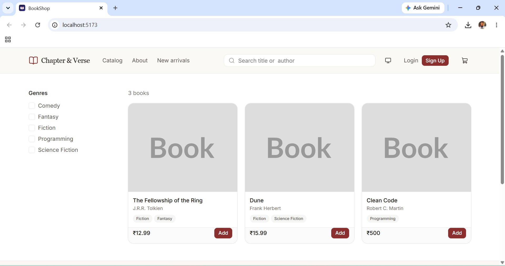
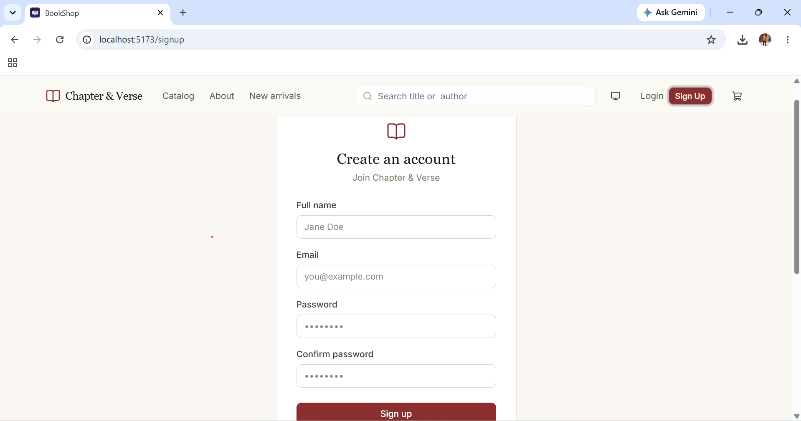
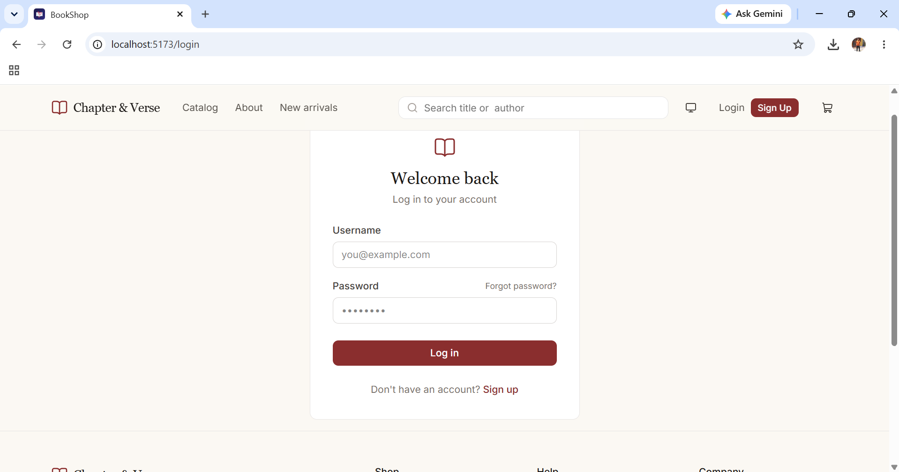
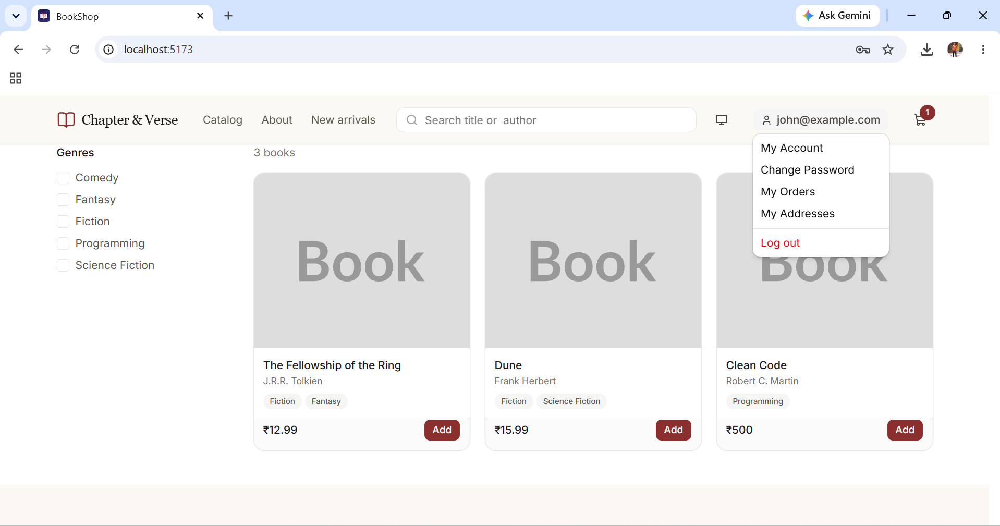
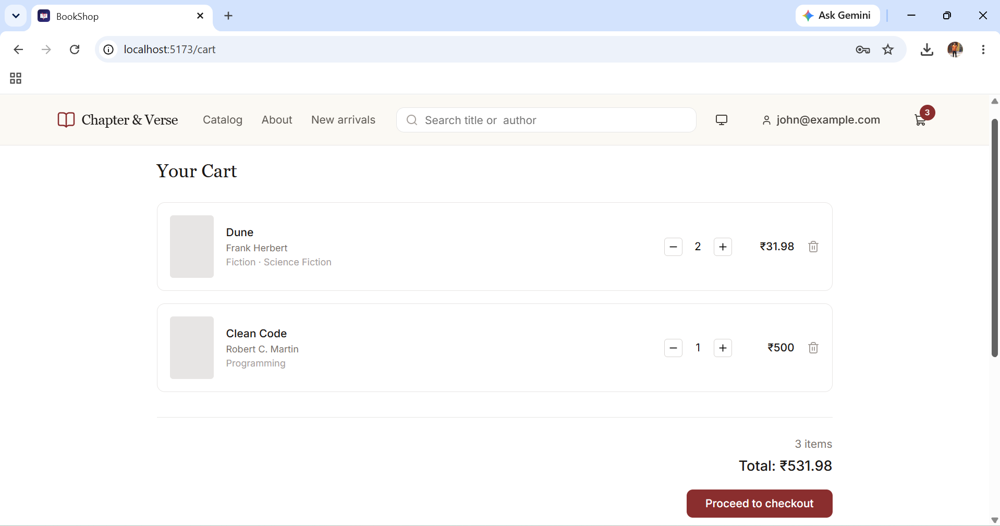
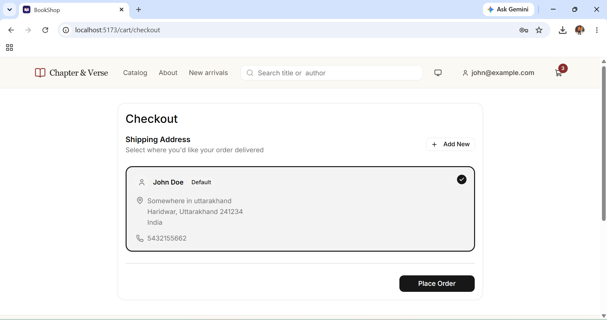
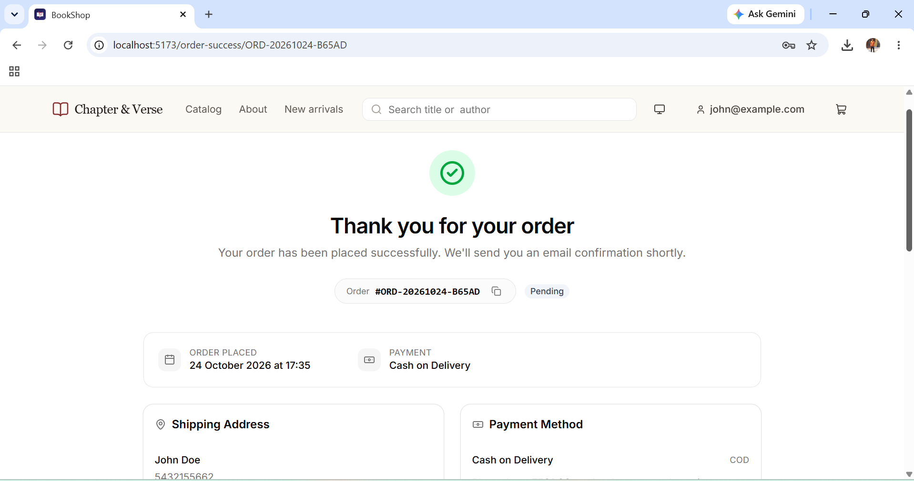
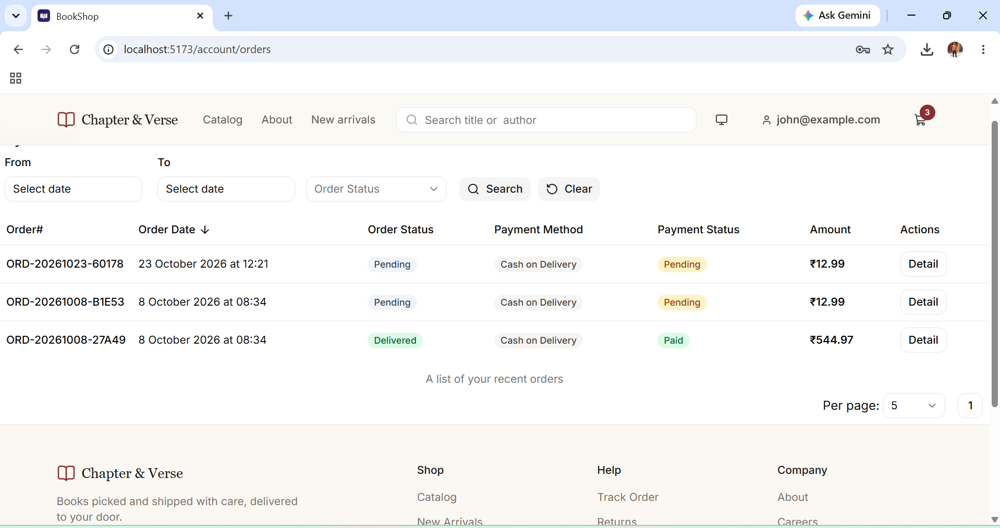
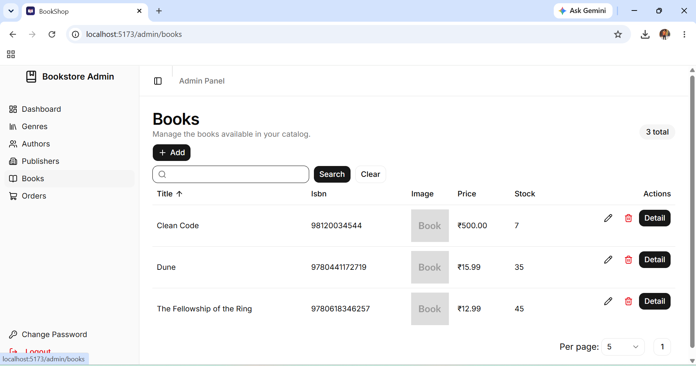

# Chapter & Verse

A web app for selling books.

## Tech used

- **Backend:** .NET 10
  - **Database:** Sqlite
  - **ORM**: Entity Framework Core

- **Frontend:** React 19
  - React hook form (form)
  - Zod (shema validation)
  - Tanstack query (server side state management and client side caching)
  - Shadcn (UI library)

## How to run project

- Clone the repo by firing `git clone https://github.com/rd003/BookShop.git`

- Run these commands in a sequence to run the dotnet app

```sh
# change directory
cd BookShop.Api

## run
dotnet run
```

- For running the front-end, run these commands in a sequence.

```sh
## Change directory
cd BookShop.Client

## Install dependencies
npm install

## run
npm run dev
```

## Admin credentials

When you run the app, it automatically creates the admin user with these credentials:

```txt
username: admin@example.com
password: Admin@123
```

## Screenshots

catalog:



signup:



Login:



user menu:



Cart:



Select shipping address:



Order success:



User orders:



Admin panel

